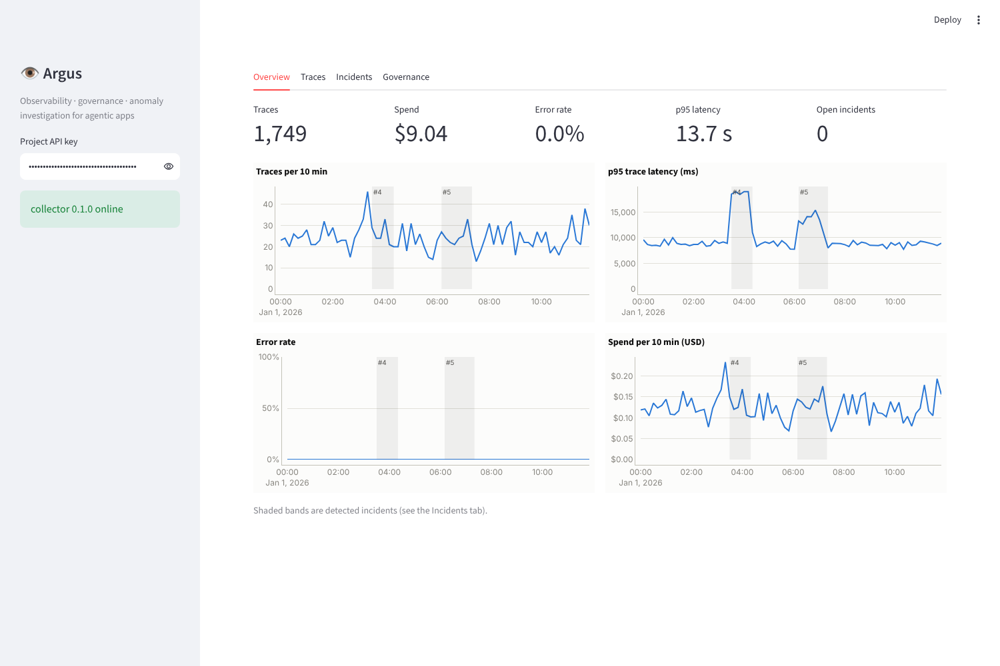
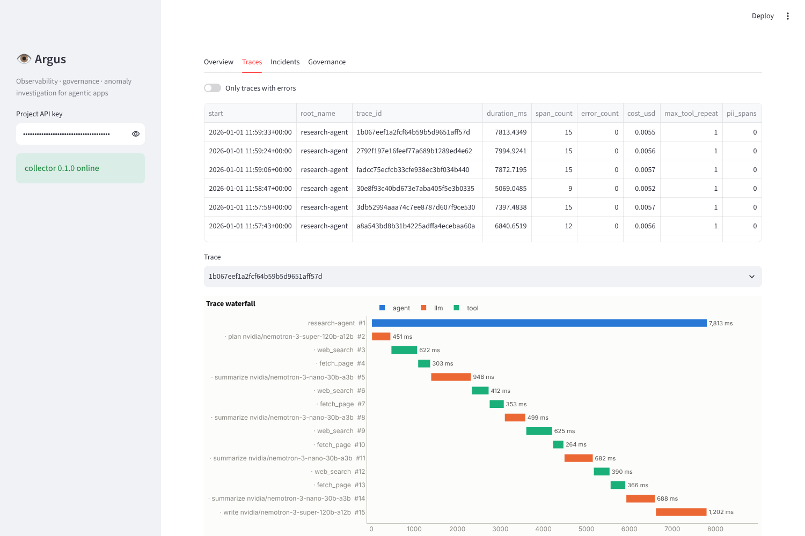
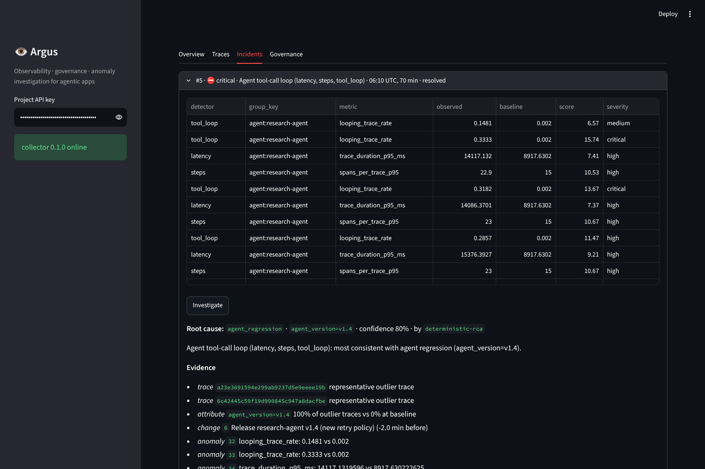
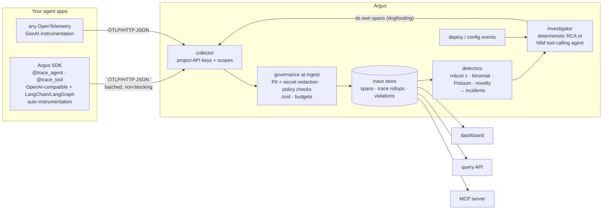

# Argus: Observability and Governance for Agentic AI

**A self-hosted observability platform for LLM agents.** It traces every agent run, LLM call and tool call;
enforces data governance before anything is stored; detects anomalies with statistics; and uses an
investigator agent on NVIDIA NIM to explain them, with evidence it has to back up.

 
 


Agents fail in ways classic APM doesn't see:
- an agent release that **calls the same tool with identical arguments** eight times;
- a prompt change that **triples input tokens** while latency looks fine;
- a tool that starts **leaking customer emails into prompts**, which then sit in your trace store;
- one model endpoint **slowing down across every app** that uses it.

Argus is built for those failures, and for the governance questions that come with them: who can
read prompt content, which models are approved, and how long data is kept.

| Overview: incidents shaded on the time series | Trace waterfall | Incident with root-cause report |
|---|---|---|
|  |  |  |

<sub>Screenshots from `argus demo` (simulated workload); the RCA shown is the deterministic investigator.</sub>

---

## Architecture



### 1. Instrumentation SDK (`src/argus/sdk`)

- **Zero-dependency tracer.** Spans nest through `contextvars`, so `asyncio.gather` and threads keep the
  right parent. Decorators record inputs, outputs and a stable hash of tool arguments.
- **Auto-instrumentation.** `instrument_openai(client)` works for NVIDIA NIM, vLLM and OpenAI, sync,
  async and streaming. It records model, provider, token usage, messages and completion.
  `ArgusCallbackHandler` turns a LangChain/LangGraph run tree into a span tree.
- **GenAI semantic conventions** (`gen_ai.*`). Export is **standard OTLP/JSON**, so the collector also
  accepts traces from any OpenTelemetry GenAI instrumentation.
- **Never blocks the agent.** Export runs in a background thread with batching and retries, and drops
  (and counts) spans on overflow instead of applying backpressure.
- **Scoped tracers.** `use_tracer()` routes spans per context, so a library or a multi-tenant service can
  trace without touching the host app's global tracer. Argus uses this to trace its own investigator.

### 2. Governance at ingest (`src/argus/governance`, `config/policies.yaml`)

Governance runs **before persistence**, so sensitive data never lands in the store:

| Control | How |
|---|---|
| Sensitive-data detection | Emails, phones, SSNs (invalid ranges excluded), credit cards (Luhn-checked), IPs, and secrets (OpenAI/NVIDIA/GitHub/Slack/AWS keys, bearer tokens, private keys) in content **and** string attributes |
| Per-project handling | `redact` (`[REDACTED:EMAIL]`), `block` (drop content, keep metrics), or `allow`; `capture_content: false` stores no text at all |
| Policies | Approved models, forbidden tools, per-call token limits, per-trace cost and step limits, daily budgets. Violations are deduplicated and graded by severity (leaked secrets are critical) |
| Access control | Project-scoped API keys (stored hashed) with scopes: `ingest`, `read`, `read:content`, `investigate`, `admin`. Tenants can't read each other's traces or incidents |
| Audit of content reads | Every read of prompt/completion text is logged with the key and a stated purpose |
| Retention | Two clocks: content is scrubbed after `content_retention_days`, spans and metrics deleted after `retention_days` |
| Cost attribution | Per-span cost from a pricing table, rolled up per trace and per day |

### 3. Anomaly detection (`src/argus/detect`)

Windowed detectors compare each 10-minute window with a rolling baseline of earlier windows. The
baseline **skips windows already flagged**, so a long incident doesn't become the new normal.

| Detector | Signal | Test |
|---|---|---|
| `latency`, `cost`, `steps`, `tokens` | trace p95 latency, cost/trace, spans/trace, input tokens per LLM call | robust z-score (median/MAD) **and** ≥ 50% relative change (latency: also ≥ +100 ms) |
| `llm_latency` | per model: ms per output token (separates a slow endpoint from longer answers) | robust z, ≥ +1 ms/token |
| `error_rate`, `tool_error_rate` | traces with errors; per-tool failure rate | exact binomial tail vs. pooled baseline |
| `tool_loop` | traces repeating an identical tool call ≥ 4× | binomial |
| `sensitive_data` | traces with redacted PII/secrets | binomial |
| `throughput` | traces per window | Poisson tail |
| `new_model`, `new_tool` | first appearance after warm-up | novelty |

The absolute floors exist because significance isn't severity: an app that answers in 30 ms produces
statistically real but meaningless p95 "regressions". [Mission Control](../mission-control)'s fault drill
found that, along with two investigator bugs (provider outages labelled "model change", and error incidents
that weren't localized to a component). All three are fixed, and the benchmark below is unchanged.

Anomalies are grouped into **incidents**. Concurrent anomalies merge; back-to-back ones merge only if
they are the same kind of problem, so a slowdown followed by a data leak stays two incidents.

### 4. Investigation (`src/argus/investigate`)

The analysis tools are read-only and project-scoped, and they never return prompt content:

- `component_breakdown`: which model or tool got slower, more error-prone or more token-heavy.
- `attribute_contrast`: a BubbleUp-style contrast showing which attribute values (`model`,
  `tool_name`, `agent_version`, `prompt_version`, `error_type`) are over-represented in the bad traces
  compared with the baseline.
- `recent_changes`: deploy and config events around the incident.
- `other_projects_affected`: same-org incidents of the same kind, which point to a shared dependency.

Two investigators use these tools:

- **Deterministic RCA.** Transparent rules over the tools. It's the default and the baseline.
- **LLM investigator.** A framework-free tool-calling loop on NIM (Nemotron Super by default) with a step
  budget. Tool errors go back to the model instead of crashing the loop, and the final step forces
  `submit_report`. Each run is traced by Argus itself.

Both produce a structured `RCAReport` (category, cause, evidence, actions, confidence), and both are
held to the same check. **Every piece of evidence must exist in the data:** trace ids, change ids,
anomaly ids, and attribute values that actually occur during the incident. A report citing anything
else is flagged and its confidence capped.

---

## Evaluation

`argus eval` runs the whole system end to end:
- simulate 12 hours of three agent apps;
- inject 7 kinds of incident with known causes;
- send everything through the real OTLP ingest path;
- detect, investigate, and score against ground truth.

The sweep covers **incident intensity** (1.0 = obvious, 0.15 = barely there) × 3 seeds.

| Incident | Injected cause | Expected detection |
|---|---|---|
| provider_degradation | Nemotron Super endpoint 5× slower, across all three apps | latency, llm_latency |
| tool_failure | `search_kb` returns 503s | error_rate, tool_error_rate |
| prompt_regression | prompt v2 deploy: 3.5× input tokens | cost, tokens |
| agent_regression | agent v1.4 retries `web_search` with identical arguments | tool_loop, steps |
| model_change | switch to an unapproved model with JSON parse failures | error_rate, new_model |
| data_leak | `get_claim` returns member emails and SSNs into prompts | sensitive_data |
| traffic_surge | 4× traffic, service healthy (**control**: must not page as latency or errors) | throughput |

Unrelated "noise" deploys are also injected, so a naive "blame the last deploy" heuristic would be wrong.

Results ([`reports/eval_report.md`](reports/eval_report.md); deterministic investigator, 3 seeds per row):

| incident intensity | recall | precision | median time to detect | correct root cause (of detected) | raw PII persisted |
|---|---|---|---|---|---|
| 1.0 (obvious) | 100% | 100% | 6 min | 100% | 0 |
| 0.5 | 100% | 100% | 6 min | 100% | 0 |
| 0.25 | 85% | 100% | 7 min | 100% | 0 |
| 0.15 (barely there) | 67% | 100% | 14 min | 94% | 0 |

- **No false incidents at any intensity**, and the healthy traffic surge never pages as a latency or error
  problem.
- **What gets missed first** as signals weaken: surges and prompt regressions (a 1.4× token increase sits
  inside normal variance), then subtle tool failures. Provider slowdowns and unapproved models are still
  caught at 0.15.
- **Correct root cause** means both the category and the exact culprit (model, tool, prompt version or
  agent version). All cited evidence passed validation in 99% of reports.
- **No raw PII persisted:** after every run, the entire store is re-scanned with the detectors, and
  nothing sensitive is found in stored text.

**How to read this.** I wrote the simulator and the detectors together, so these numbers show the system
works end to end and degrades gracefully as signals weaken. They are not a claim about production
accuracy. The informative part is the low-intensity rows, which show what goes undetected first.
Run `argus eval --llm` with an `NVIDIA_API_KEY` to score the NIM investigator against the deterministic
baseline on the same incidents.

---

## Quickstart

```bash
cd agent-observability
uv venv && uv pip install -e ".[dev,ui]"
argus demo                                  # 12 h of simulated traffic + incidents; prints project API keys
argus serve                                 # collector + API on :8003
ARGUS_API_KEY=<key> streamlit run ui/app.py # dashboard: overview, trace waterfall, incidents, governance
```

**Instrument your own agent**

```python
from argus.sdk import init, trace_agent, trace_tool
from argus.sdk.instrument.openai import instrument_openai

init(endpoint="http://localhost:8003", api_key="argus_...", service="support-bot")
client = instrument_openai(AsyncOpenAI(base_url="https://integrate.api.nvidia.com/v1", api_key=NVIDIA_API_KEY))

@trace_tool("search_kb")
def search_kb(query: str) -> str: ...

@trace_agent("support-bot", version="v1.2")
async def answer(question: str) -> str: ...
```

LangGraph: `graph.invoke(state, config={"callbacks": [ArgusCallbackHandler()]})`. See [`examples/`](examples).

**Investigate**: `argus investigate <project_id> <incident_id> [--llm]`, `POST /v1/incidents/{id}/investigate`,
or from Claude Desktop/Cursor through the MCP server (`ARGUS_MCP_API_KEY=<key> argus mcp`). The MCP server
exposes incidents, breakdowns, contrasts, changes, traces and violations, plus `investigate` only for keys
with that scope.

| Endpoint | Scope |
|---|---|
| `POST /v1/traces` (OTLP/JSON) · `POST /v1/events` (deploys/config changes) | `ingest` |
| `GET /v1/traces`, `/v1/traces/{id}` (content only with `read:content`, and logged), `/v1/metrics/summary` | `read` |
| `GET /v1/incidents`, `/v1/incidents/{id}`, `/v1/violations`, `/v1/policy`, `/v1/content-access-log` | `read` |
| `POST /v1/detect`, `POST /v1/incidents/{id}/investigate` | `investigate` |
| `POST /admin/projects`, `/admin/projects/{id}/keys` | `X-Admin-Token` |

---

## Design decisions

- **Statistics detect; agents explain.** Detection runs on every window and must be cheap, deterministic
  and testable. The LLM runs only when there is an incident to explain, and only over aggregated tool
  output, never raw prompts.
- **Governance before persistence.** Redacting at query time leaves the data in the database; Argus
  redacts at ingest, and the benchmark re-scans the whole store to prove it.
- **Standard wire format.** OTLP/JSON plus GenAI semantic conventions means no lock-in: the SDK is
  optional.
- **Baselines exclude incidents**, and continuous detectors need both a robust z-score and a relative
  change, so tiny-variance metrics don't page on noise.
- **The investigator is a plain loop, not a framework.** The control flow (budget, forced final answer,
  tool-error handling, evidence validation) is explicit and testable with a scripted client.

## Limitations and next steps

- SQLite with per-trace rollups is fine for one node and demo scale. Next: a ClickHouse or DuckDB backend
  for analytics and a queue between collector and processing.
- Detection runs in windows. Next: streaming detection, seasonality-aware baselines (time-of-day), and
  LLM-as-judge quality signals (answer relevance, hallucination) as detector inputs.
- OTLP/protobuf, OTLP metrics and logs aren't ingested yet; only OTLP/JSON traces are.

## Project layout

```
src/argus/
  sdk/            tracer, OTLP encoder, exporters, OpenAI + LangChain instrumentation
  ingest/         OTLP decode, normalization, pipeline, trace rollups
  governance/     PII/secret detection, policies, pricing
  store/          SQLite store (tenants, keys, spans, incidents, audit log)
  detect/         robust statistics, detectors, incident grouping
  investigate/    analysis tools, deterministic RCA, NIM tool-calling investigator, report validation
  simulate/       synthetic agent workloads with labeled incidents
  evals/          detection + RCA benchmark
  api/ mcp_server.py cli.py service.py
ui/app.py         Streamlit dashboard
examples/         NIM agent and LangGraph app instrumented with Argus
tests/            SDK, governance, detection, investigation, API and MCP tests (offline)
```

All workloads, apps and data in this repository are synthetic.
