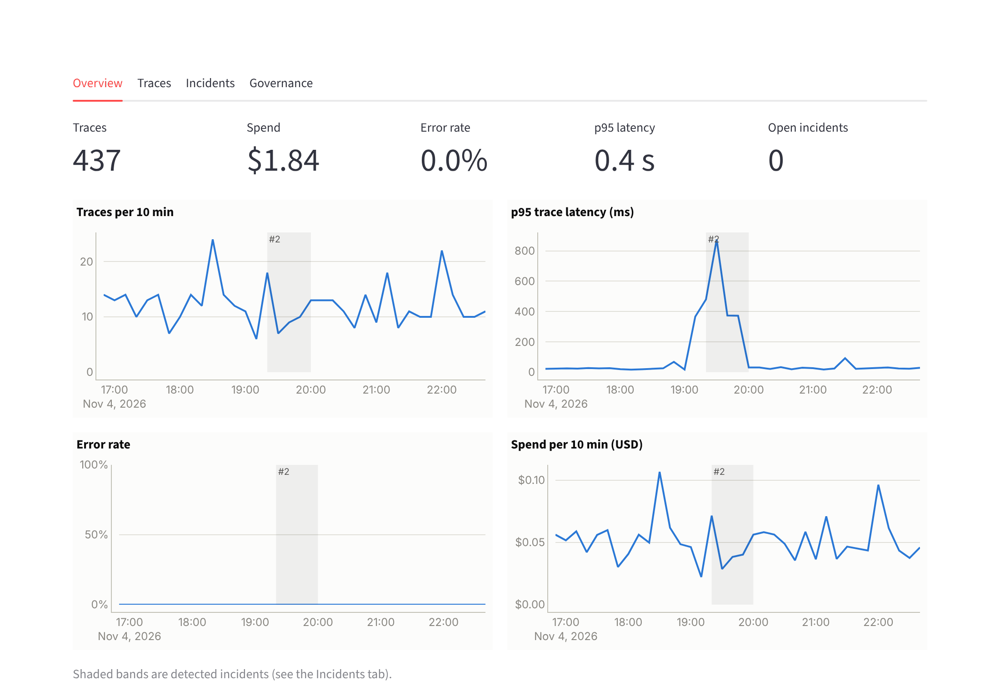
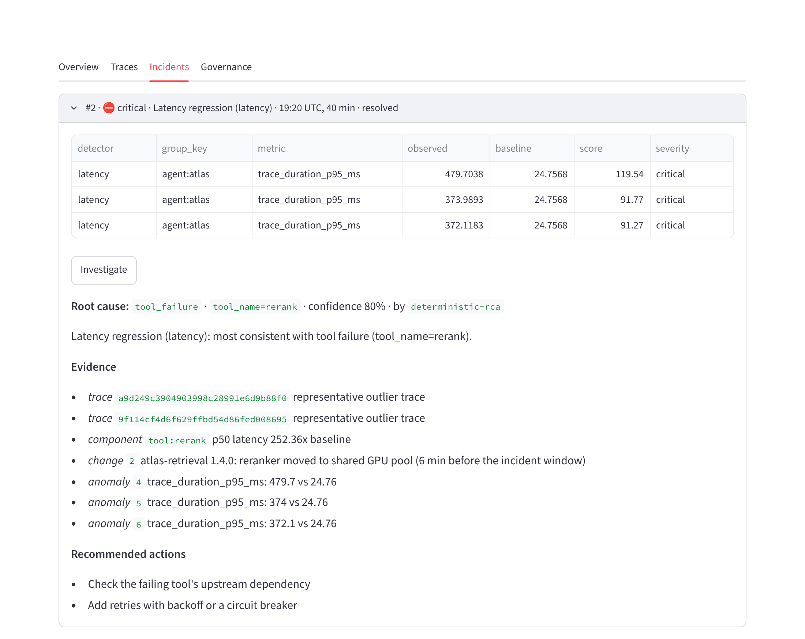
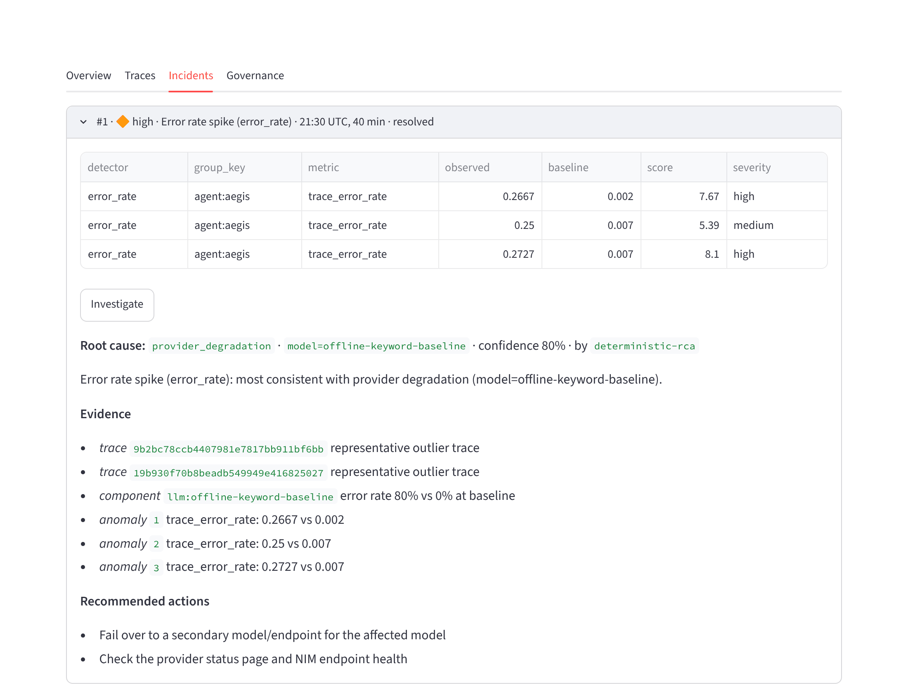
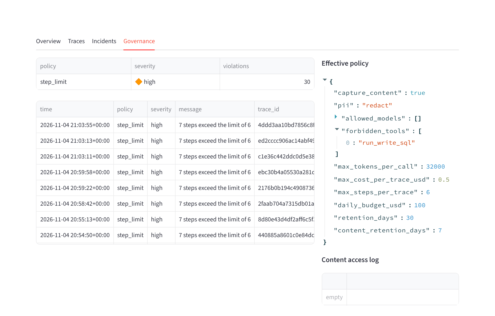

# Mission Control: three agentic apps on one observability platform, under fire

**Atlas (GraphRAG), Quill (governed text-to-SQL) and Aegis (multi-agent claims auditing) run as one
company's production fleet, sending traces to [Argus](../agent-observability). Three realistic incidents
are injected without telling Argus. Argus has to find each one, localize it, and explain it with
evidence.**

 
 


Each project in this repo is tested on its own. This one tests them together, as an on-call engineer
would experience them: one org, three tenants, a deploy calendar, and incidents nobody announced.

```
$ mission-control drill --seeds 1 2 3
seed 1: 1,554 requests in 49 s · detected 3/3 · root cause 3/3 · false alarms 0
seed 2: 1,567 requests in 59 s · detected 3/3 · root cause 3/3 · false alarms 0
seed 3: 1,614 requests in 50 s · detected 3/3 · root cause 3/3 · false alarms 0
```

Full report with timeline, evidence and business impact: [`reports/drill_report.md`](reports/drill_report.md).

---

## The drill

```mermaid
flowchart LR
    subgraph fleet [Org "helix": three tenants]
      A[Atlas<br/>GraphRAG agent]
      Q[Quill<br/>text-to-SQL]
      G[Aegis<br/>claims auditor]
    end
    F1{{F1 slow reranker}} -.-> A
    F2{{F2 prompt sql-v2}} -.-> Q
    F3{{F3 model timeouts}} -.-> G
    A & Q & G -- OTLP spans<br/>agent · llm · tool --> ING[Argus ingest<br/>PII redaction · policies · cost]
    CH[(deploy calendar<br/>change events)] --> RCA
    ING --> DET[detectors<br/>10-min windows] --> INC[incidents] --> RCA[investigator<br/>deterministic or NIM agent]
    RCA --> SC[scorer<br/>vs. injected faults]
```

| | Fault (hidden from Argus) | What changed | Argus should conclude |
|---|---|---|---|
| **F1** | Atlas's reranker slows down after a retrieval deploy moves it to a shared GPU pool | a deploy, then a config revert 45 min later | `tool_failure`, `tool_name=rerank`, linked to the deploy |
| **F2** | Quill ships prompt `sql-v2`: 3× longer, and it nudges the model to `SELECT` member names and DOBs. The guard blocks every one of those queries, so nothing leaks, but each costs a repair round-trip | a prompt release, rolled back 45 min later | `prompt_regression`, `prompt_version=sql-v2`, linked to the release |
| **F3** | Aegis's reviewer model endpoint times out on 70% of calls | **nothing**: a provider-side incident, no deploy to blame | `provider_degradation` on the reviewer model, *not* a "model change" |

The faults are distinct on purpose. F1 is latency with a deploy that matches it. F2 is cost and steps
with a version that matches it. F3 is errors with no change at all. A detector that "always blames the
last deploy" fails F3, and one that only watches error rates misses F1 and F2.

### Results (offline providers, 3 seeds)

| | detected | root cause correct | median time to detect | false alarms |
|---|---|---|---|---|
| per seed | 3/3, 3/3, 3/3 | 3/3, 3/3, 3/3 | 11, 9, 9 min | 0, 0, 0 |

What the business saw during each fault, and what Argus attached to its incident (seed 1):

| Fault | User-visible symptom | Argus's evidence |
|---|---|---|
| F1 | Atlas p50 latency 19 ms → **377 ms** | `tool:rerank` p50 ~250× baseline; deploy *"reranker moved to shared GPU pool"* 6 min before |
| F2 | 1.56 SQL attempts per question (was 1.0); 30 `step_limit` policy violations | `prompt_version=sql-v2` on 100% of outlier traces vs 3% at baseline; the prompt release 1 min before |
| F3 | claims sent to human review 0% → **25%** | `llm:<reviewer model>` error rate 80% vs 0%; no matching change, so the provider is blamed |

Detection delay is bounded below by the 10-minute window: the first possible alert lands when the
first full window inside the fault closes.

---

## What on-call sees

Argus's dashboard on the drill's data, one tenant at a time (`mission-control dashboard --app atlas`).

**Atlas, F1.** p95 latency jumps from ~25 ms to ~480 ms. The shaded band is the incident Argus opened.

<picture>
  <source media="(prefers-color-scheme: dark)" srcset="docs/img/atlas_overview_dark.png">
  
</picture>

**The explanation attached to that incident.** The slow component (`tool:rerank`, ~250× its baseline
p50), the deploy that moved it 6 minutes before, and the anomalies behind it. Every reference is checked
to exist.

<picture>
  <source media="(prefers-color-scheme: dark)" srcset="docs/img/atlas_incidents_dark.png">
  
</picture>

**Aegis, F3.** Errors on the reviewer model, with no matching change, so the provider is blamed rather
than a deploy.

<picture>
  <source media="(prefers-color-scheme: dark)" srcset="docs/img/aegis_incidents_dark.png">
  
</picture>

**Quill, F2, governance view.** The prompt regression's repair loop also breaks the tenant's
`max_steps_per_trace` policy, so it appears as violations as well as in detection.

<picture>
  <source media="(prefers-color-scheme: dark)" srcset="docs/img/quill_governance_dark.png">
  
</picture>

---

## How it works

**No application code was changed to add observability.** Each app is built against a small provider
protocol: Atlas `generate`/`structured`/`stream`, Quill `complete`, Aegis `complete_json`. Each also
has a few internal components: reranker, SQL guard, executor, rules engine.
[`instrument.py`](src/mission_control/instrument.py) wraps those seams from the outside, emitting
OpenTelemetry GenAI spans (`chat {model}`, `execute_tool`, `invoke_agent`) with tokens, prompt and agent
versions, and content. Argus's redaction and policies decide what is stored.

**Faults are injected below the instrumentation** ([`faults.py`](src/mission_control/faults.py)), so
the apps and the traces see them as they would in production. The slow reranker is really slow. The
timeouts really raise, and Aegis really degrades those claims to human review. The prompt regression is
keyed on the *deployed prompt version*, so it starts on release and stops on rollback.

**Replay clock** ([`timeline.py`](src/mission_control/timeline.py)). Every request runs for real:
LangGraph graphs, SQL against a 25k-claim warehouse, the rules engine, the hash-chained ledger. Only
each trace's start time is placed on a virtual six-hour timeline, by shifting span timestamps at export.
Durations are never changed. That lets 1,500 requests fill Argus's 10-minute windows in about a minute
of wall-clock time.

**Tenancy.** One Argus org, one project per app, a read-only dashboard key per tenant. Each app's spans
land only in its own project (tested), and each has its own governance policy: Aegis blocks content with
identifiers because clinical notes are PHI, and Quill caps steps per trace
([`config/policies.yaml`](config/policies.yaml)).

### What the drill changed in Argus

A drill is only useful if it finds problems. This one found three in Argus's investigator and detectors,
all fixed in [`agent-observability`](../agent-observability):

1. **Provider outages were reported as "model change".** The "is this model new?" check only looked at
   failing spans. Those never occur in a healthy baseline, so any failing model looked new. It now
   requires that the model served **no calls** before the incident.
2. **Error incidents fell back to a vague `error_type`.** Errors are now localized to the component whose
   error rate rose the most (a model means provider, a tool means tool failure), and linked to matching
   change events.
3. **Millisecond jitter paged people.** Apps answering in about 30 ms produced statistically significant
   but meaningless p95 "regressions". The detectors now have alerting floors (+100 ms for trace p95,
   +1 ms/token for LLM latency).

Argus's own benchmark is unchanged after these fixes; see its
[eval report](../agent-observability/reports/eval_report.md).

---

## Run it

```bash
cd mission-control
uv venv && uv pip install -e ".[dev,ui]"     # installs the four sibling projects in editable mode

mission-control drill                         # one seed, offline providers, ~1 min
mission-control drill --seeds 1 2 3           # the committed report
mission-control dashboard --app aegis         # Argus API + dashboard on the drill's data, as that tenant

# With NVIDIA NIM: real Nemotron models in all three apps, and Argus's LLM investigator
export NVIDIA_API_KEY=nvapi-...
mission-control drill --provider nvidia --minutes 240 --llm-rca --out reports/drill_report_nim.md
```

With `--provider nvidia`, the injected delays scale to NIM's normal latency (2.5 s rerank slowdown,
5 s timeouts), and span `gen_ai.request.model` attributes carry the real model ids. Offline, they carry
the name of each app's deterministic baseline, so the expected cause of F3 is that model name.

```
src/mission_control/
  instrument.py   tracing proxies for the three apps' provider protocols and components
  faults.py       fault injectors (slow dependency, prompt regression, provider timeouts)
  timeline.py     replay clock: virtual start times, real durations
  apps.py         boot + instrument Atlas, Quill and Aegis
  drill.py        scenario, traffic replay, detection, investigation, scoring
  report.py       Markdown report
config/policies.yaml   per-tenant governance
tests/                 unit tests + an end-to-end drill that must catch and explain every fault
```

## Limitations

- Token counts are estimated (~4 chars per token, flagged `argus.usage.estimated`), because the provider
  protocols return text rather than usage blocks. With NIM, Argus's `instrument_openai` gives exact usage.
- Offline providers answer in milliseconds, so latency faults are sized in absolute terms. A NIM run
  takes real time: 240 virtual minutes is about 1,000 model-backed requests.
- One scenario, three fault types. Next: randomize fault types and timing per seed, and add a cross-tenant
  incident (one shared NIM endpoint degrading two apps at once) to test Argus's cross-project correlation.
