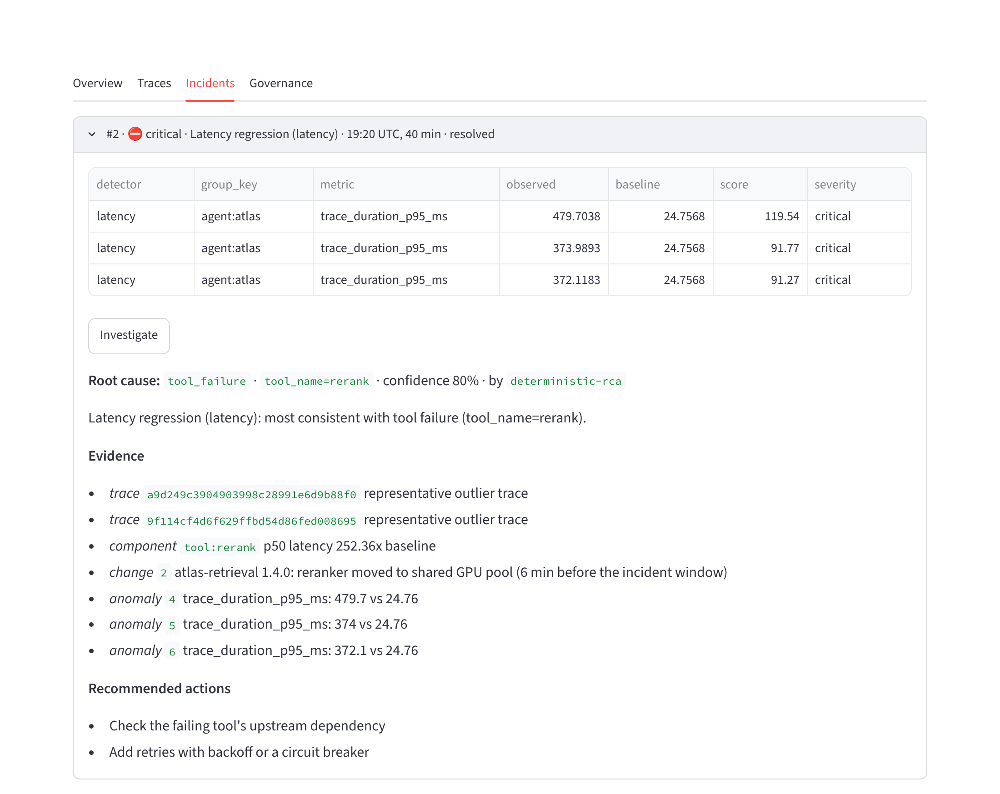

<!-- GitHub profile README. Publish by copying this file to the special repo niraJKuMAR789/niraJKuMAR789. -->

### Hi, I'm Niraj 👋

**AI Engineer (3+ years)** building production LLM, RAG and agentic systems for enterprise clients in
finance, healthcare and real estate. I'm open to **AI Engineer, Forward Deployed Engineer and ML Engineer**
roles.

- Today, at Prudent Technologies, I ship corrective RAG with LangGraph, MCP servers, text-to-SQL agents,
  agentic medical-claims auditing, and computer vision for client teams
- I care about the parts that make AI usable in regulated settings: evaluation, guardrails, auditability
  and observability
- Claude Certified Architect · Databricks ML Associate · Azure AI Associate

---

### Featured work: [AI_POCs](https://github.com/niraJKuMAR789/AI_POCs)

Five production-style projects in one monorepo. Each has typed Python, CI that runs offline without API
keys, Docker, and an evaluation harness. Models are served through **NVIDIA NIM**.

| | Project | The hard part it solves |
|---|---|---|
| 🧭 | [**Atlas: Adaptive GraphRAG agent**](https://github.com/niraJKuMAR789/AI_POCs/tree/main/adaptive-graphrag) | Multi-hop and corpus-wide questions that plain vector search can't answer: adaptive routing, hybrid + knowledge-graph retrieval, CRAG grading and Self-RAG reflection in LangGraph, plus an MCP server |
| 🪶 | [**Quill: Governed text-to-SQL**](https://github.com/niraJKuMAR789/AI_POCs/tree/main/governed-text2sql) | Treats the model as untrusted: RBAC, PII column protection and row-level security are enforced on the SQL AST, with self-repair, an Agno agent with human-approved writes, a red-team leak suite, and a LoRA fine-tuning pipeline scored on held-out query shapes |
| 🛡️ | [**Aegis: Multi-agent claims auditor**](https://github.com/niraJKuMAR789/AI_POCs/tree/main/claims-audit-agents) | Rules decide what must be exact. LLM specialists judge clinical notes, but only with verbatim evidence and policy citations. Uncertain cases pause for a human (durable LangGraph interrupt), and every step is hash-chained. Benchmarked in dollars overpaid |
| 👁️ | [**Argus: Observability for agents**](https://github.com/niraJKuMAR789/AI_POCs/tree/main/agent-observability) | Self-hosted tracing (OTLP + GenAI semantic conventions), PII redaction and policies before storage, statistical anomaly detection, and an investigator agent whose root-cause claims must cite real evidence |
| 🚨 | [**Mission Control: the fleet under fire**](https://github.com/niraJKuMAR789/AI_POCs/tree/main/mission-control) | All of the above as one production fleet. Three unannounced faults (a slow dependency, a bad prompt release, a provider outage) are injected; Argus detects and correctly explains **9/9 with 0 false alarms** across 3 seeds |

<picture>
  <source media="(prefers-color-scheme: dark)" srcset="https://raw.githubusercontent.com/niraJKuMAR789/AI_POCs/main/mission-control/docs/img/atlas_incidents_dark.png">
  
</picture>

Argus explaining an incident it wasn't told about: the slow component, the deploy that caused it,
and the anomalies behind it.

---

### How I build

- **Evaluation first.** Golden sets, baselines to beat, and numbers committed to the repo, including the
  unflattering ones
- **The model is untrusted.** Guardrails live in code (AST checks, evidence validation, policy engines),
  not only in prompts
- **Humans where it matters.** Durable approvals and audit trails for decisions that cost money or touch PHI
- **Observable by default.** If an agent is in production, I want to know when it breaks and why

**Stack:** Python · LangGraph · Agno · MCP · NVIDIA NIM / Nemotron · OpenTelemetry · FastAPI · Qdrant ·
Neo4j · sqlglot · TRL / PEFT · Databricks · Azure · Docker
